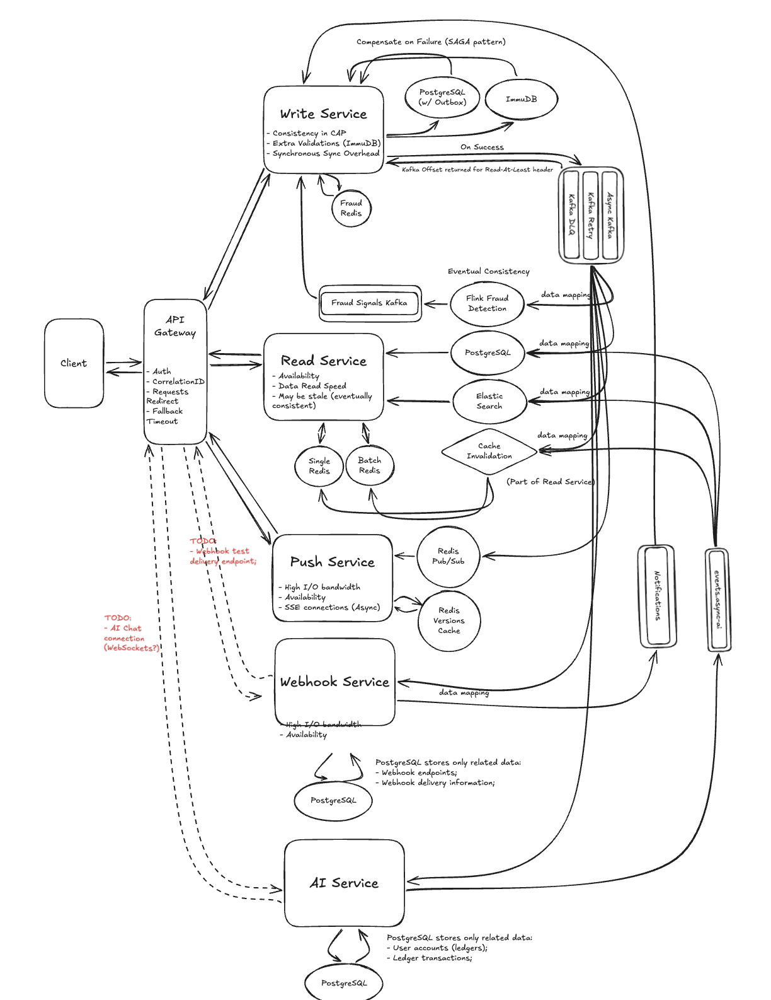

# Power Finance

**Live:** [nikitalapin.dev/projects/power-finance](https://nikitalapin.dev/projects/power-finance)

The demo runs against the production deployment with no sign-up: each visitor gets
a guest session on a seeded demo user. Requests made from the page are traced end
to end, and the trace stream is pushed back to the page live, so you can watch a
write travel through the gateway, the outbox, Kafka and every consumer.

> A learning-grade personal finance backend built on **CQRS**: a consistency-first
> write side and an availability-first read side, bridged by a Kafka transactional
> outbox, with read-your-writes, real-time SSE, signed webhooks and streaming fraud
> detection.

<p align="center">
  
</p>

<p align="center">
  
  
  
  
  
  
</p>

## System design

| Service | Stack | Role |
| --- | --- | --- |
| **write-service** | Python · Django | Commands → Postgres + transactional outbox; ImmuDB audit mirror with SAGA compensation; idempotency |
| **read-service** | Python · Django | Projects `events.async` into Postgres and Elasticsearch read models; Redis caches |
| **push-service** | Go | Fans `events.async` out to clients over SSE, authenticated per user |
| **webhook-service** | Go | Signed (HMAC) webhook delivery with retries and a DLQ; owns its Postgres |
| **ai-service** | Python · FastAPI | Double-entry postings behind each transaction; assistant surface |
| **antifraud-service** | Java · Apache Flink | Stateful per-user fraud scoring over the event stream |

Key ideas:

- **CQRS without a shared database.** The write side commits domain changes and
  outbox rows in one transaction; Debezium ships them to Kafka, keyed by user for
  per-user ordering.
- **Opt-in read-your-writes.** Write responses carry a signed `Read-At-Least`
  version. A read model that has not caught up answers `507`, and the gateway falls
  back to the write side's consistent endpoints.
- **Kong as the edge.** In-tree Lua plugins handle Clerk JWT auth, the
  Read-At-Least sign/verify pair, read fallback, sandbox routing and two-tier rate
  limiting.
- **Observability.** OpenTelemetry context crosses HTTP, the outbox and Kafka
  headers, so a single trace follows a request through every service.

Shared code lives in `libraries/` (Kafka clients, consumer runtime, SAGA,
Read-At-Least, observability, protobuf messages); infrastructure is in
`infrastructure/`. The full specification is in
[docs/architecture.md](docs/architecture.md).

## Dev environment and sandboxes

The full stack is about 30 containers and needs 12–13 GB of memory, which does not
fit a stack per developer. Instead, one dev host runs a single **baseline** stack
(everything at `main`) and each developer works in a **sandbox** that contains only
the service they are changing ([ADR-0002](docs/adr-0002-shared-dev-environment.md)).

- **Clone, edit and run on your laptop.** You run the service locally with your own
  debugger; Kafka, Postgres, Elasticsearch, Redis, the gateway and every other
  service come from the dev host over SSH tunnels on a tailnet. Locally you need
  only `uv` and Python (Go or a JDK if you change those services). No Docker.
- **Routing by baggage.** The sandbox id travels in the W3C `baggage` header. Kong's
  `sandbox-router` plugin sends a request to your process only for the services
  your sandbox overrides; everything else goes to the baseline.
- **Event ownership.** The id follows the event through the outbox into Kafka
  headers. Sandbox consumers run in their own consumer groups, and exactly one side,
  the baseline or the sandbox, handles any message
  ([ADR-0003](docs/adr-0003-sandbox-event-fallback.md)).
- **Isolation when needed.** `ISOLATED=1` gives a sandbox its own Postgres and
  prefixed Elasticsearch indices for migrations or projection changes; its events
  can be replayed into the baseline afterwards.

Setup steps are in the [dev host guide](infrastructure/deploy/sandbox/README.md).

## Running locally

```bash
make install            # sync the uv workspace and install the pre-commit hook
docker compose up -d    # the whole stack; the gateway listens on localhost:8080
make test               # every service, library, contract and gateway suite
```

`make help` lists all targets. `make <service> <subcommand>` routes to a
service's own Makefile (for example `make write up` or `make webhook migrate`).

## Documentation

- [Architecture spec](docs/architecture.md)
- [ADR-0001: fraud service on Java/Flink](docs/adr-0001-fraud-service.md)
- [ADR-0002: shared dev environment](docs/adr-0002-shared-dev-environment.md)
- [ADR-0003: sandbox event fallback](docs/adr-0003-sandbox-event-fallback.md)
- [Infrastructure](infrastructure/README.md): Kafka, Kong, Postgres, Debezium
- [Production](infrastructure/deploy/production/README.md): three Oracle A1 VMs behind a Cloudflare Tunnel

## AI integrity statement

AI assistance was used in this project, but it did not drive any decisions. Every
architectural and design choice was made by the author, and all AI-written code was
reviewed by hand before it was merged.

| Area | AI involvement |
| --- | --- |
| Writing tests | High |
| Project structure | Low |
| Key features and abstractions | Low |
| Decision making | None |
